# Password Cracking & Hash Extraction Phases
### W3-PM1 & PM2 | CYBERSECURITY | NETWORKWALKS

| Field | Detail |
|---|---|
| Name | `Muhammad Rizki Saputra` |
| Program/Batch | `B084` – Networkwalks |
| Date | `19 November 2026` |
| Modules completed | W3-PM1 (John the Ripper / Johnny GUI) <br> W3-PM2 (Password Cracking with Networkwalks Tools) |
| Client/Target | Authorised lab sample files: `My Locked PDF1.pdf` and `My Locked PDF1 (for NW Tools Lab WK3-PM2).pdf` |
| Permission secured? | Yes, both files were supplied by the course for this exercise |
| Phases covered | Phase 1: Hash Extraction & Format Conversion <br> Phase 2: Local Dictionary Attack (John the Ripper / Johnny) <br> Phase 3: Web-Based Dictionary Attack (Networkwalks Tools) <br> Phase 4: Document Decryption & Flag Verification |

---

## 1. Liability Disclaimer

All activities in this report were carried out only on the sample files provided by the Networkwalks course for this lab. These techniques are for education and research purposes only and must never be used against a file or system without explicit permission.

---

## 2. Theoretical Background & Tool Overview

**What is password cracking?**
Password cracking is the process of recovering the plaintext password behind stored data or a protected file. Security professionals run this kind of test to measure how strong a password really is and to show, in practice, why short or predictable passwords are risky.

**Encryption vs. hashing**
- **Encryption** is reversible: plaintext is turned into ciphertext with a key, and the same (or a matching) key can turn it back into plaintext.
- **Hashing** is one-way: plaintext is scrambled into a fixed-length digest that cannot be reversed directly. A protected PDF does not store its password in plaintext — it stores a hash of it (e.g. a string starting with `$pdf$...`), and that hash is what a cracking tool actually attacks.

**What is John the Ripper (JTR)?**
John the Ripper is a well-known open-source offline password cracker. It supports a huge range of hash formats and attack modes — dictionary attacks, brute-force attacks, and more — by hashing candidate words from a wordlist and comparing each result against the target hash until one matches. **Johnny** is the graphical front end for the John the Ripper command-line engine, built for people who prefer a point-and-click workflow over typing commands.

---

## 3. Methodology 1: Local Password Cracking (John the Ripper & Johnny GUI)

**Target file:** `My Locked PDF1.pdf`

### 3.1 Engine setup & configuration

Installed the Johnny GUI alongside the John the Ripper jumbo CLI build on Windows, then opened Johnny for the first time.

**Screenshot — Johnny, first launch**
 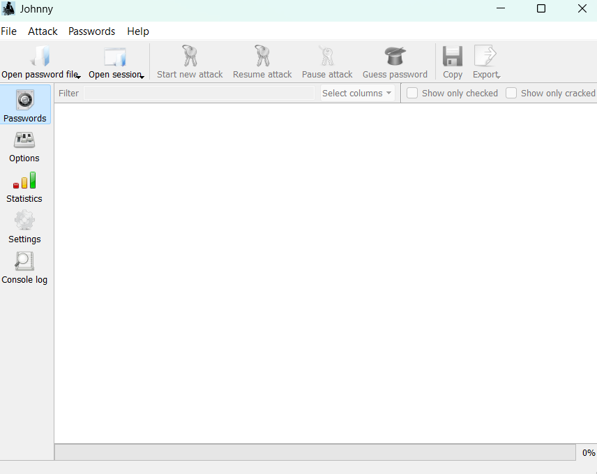

In *Settings*, linked Johnny to the core `john.exe` binary located inside the JTR `run` folder, so Johnny could hand off the actual cracking work to it. Johnny confirmed the engine as **John the Ripper 1.9.0-jumbo-1 OMP [cygwin 64-bit x86_64 AVX2 AC]**.

**Screenshot — John the Ripper executable linked in Johnny**
 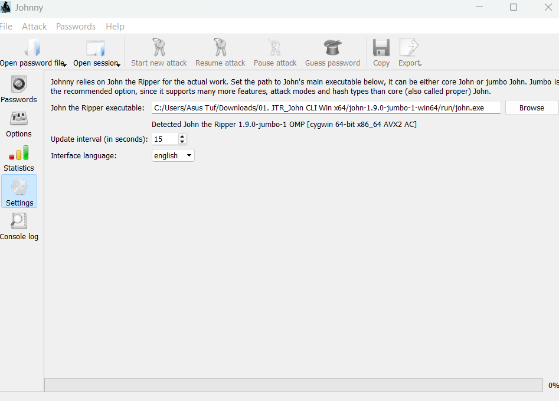

### 3.2 PDF hash extraction

Extracted the cryptographic hash of `My Locked PDF1.pdf` using a pdf2john-compatible online extractor. The result is a string starting with `$pdf$4*4*128*...`.

**Screenshot — Hash extracted from the locked PDF**
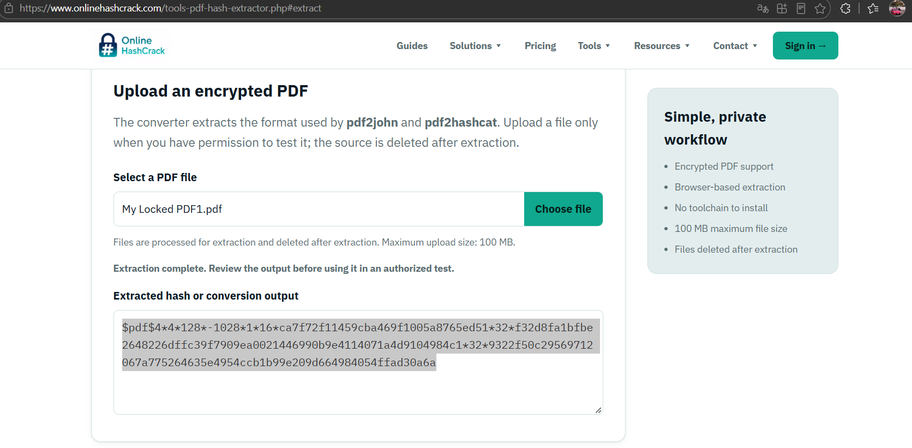

Saved that hash string into a plain text file named `hash1.txt`, making sure the value cleanly starts with `$pdf$` with no stray characters.

**Screenshot — Hash saved into hash1.txt**
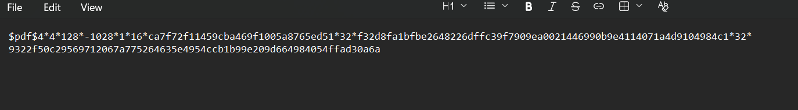

### 3.3 Executing the attack in Johnny

Loaded `hash1.txt` into Johnny through *Open password file* (PASSWD format).

**Screenshot — Opening hash1.txt in Johnny**
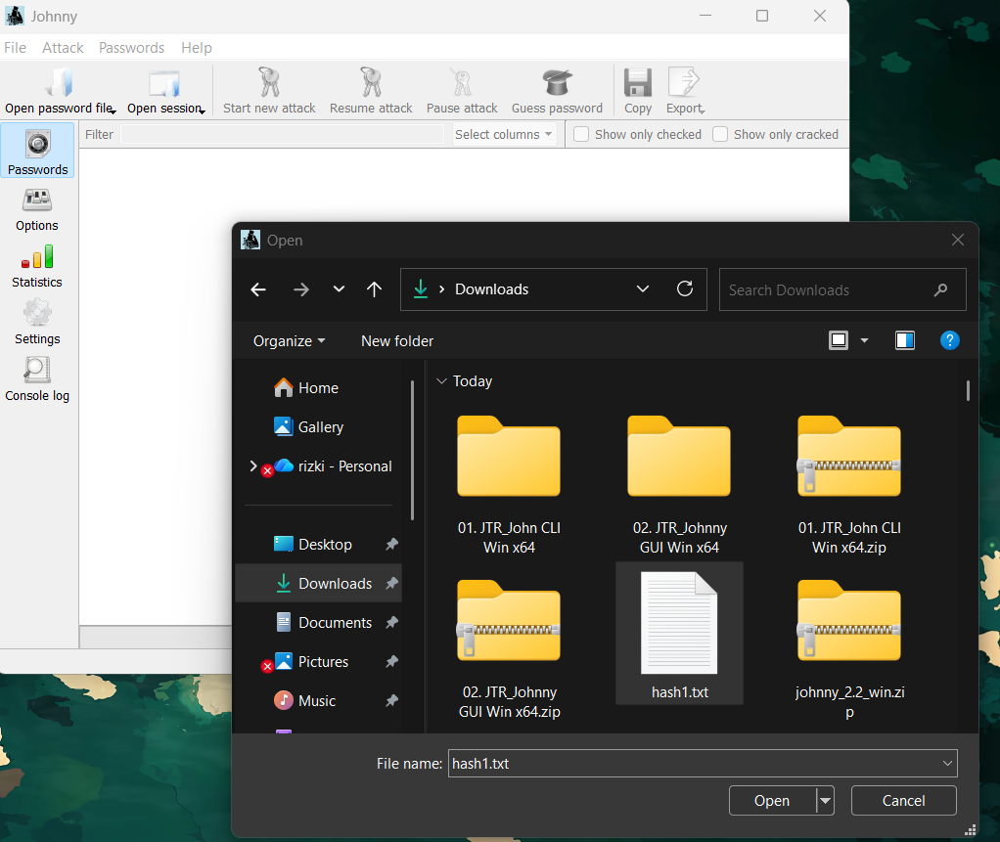

Johnny parsed the file and listed one hash entry, recognised in **PDF** format and ready to attack.

**Screenshot — Hash loaded in Johnny**
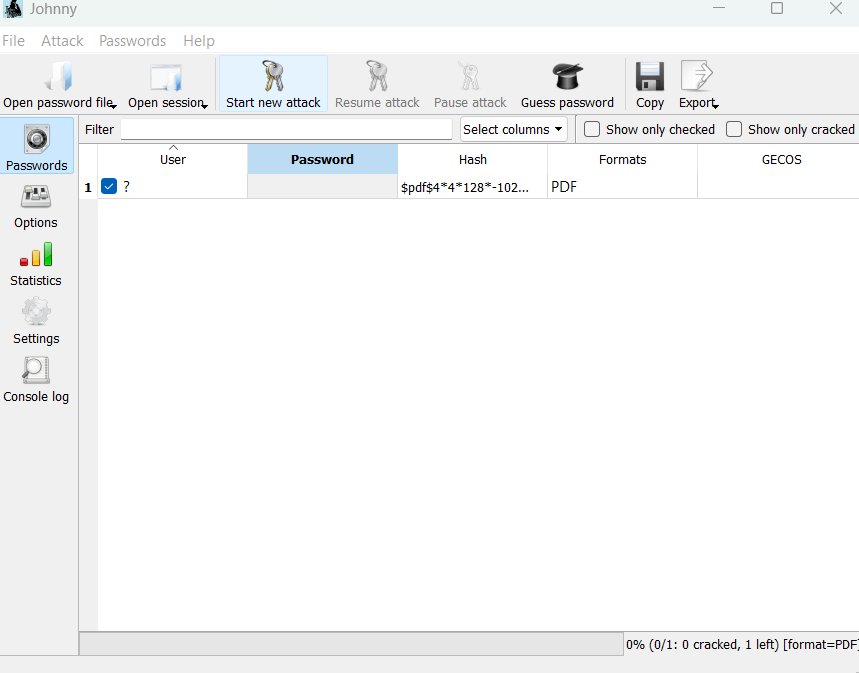

Clicked **Start new attack** to begin the cracking session.

### 3.4 Result & verification

John the Ripper matched the hash against its wordlist and recovered the plaintext password:

**Password recovered: `good-luck`** — shown at 100% (1/1 cracked, 0 left).

**Screenshot — Password cracked: good-luck**
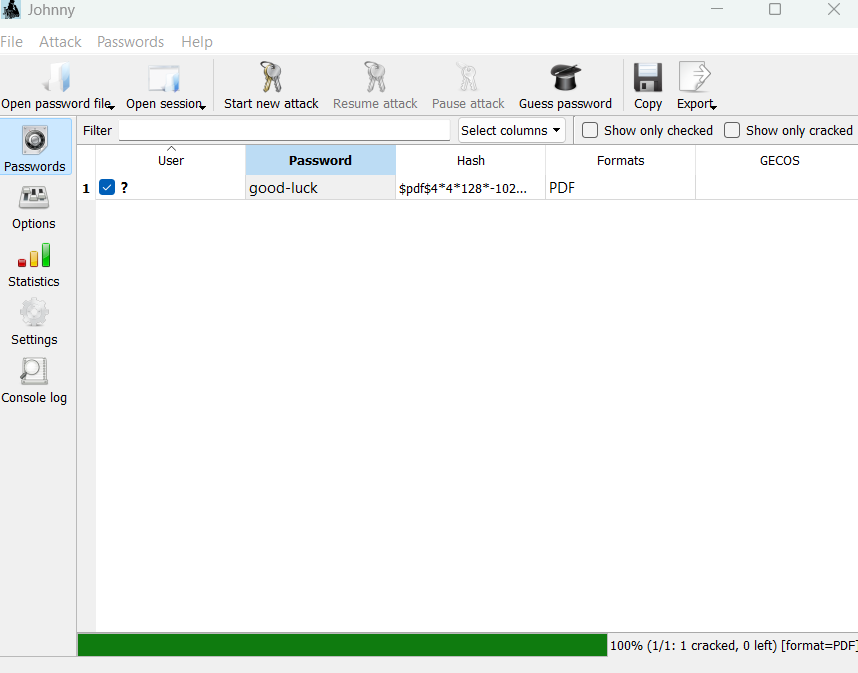

Used `good-luck` to unlock `My Locked PDF1.pdf`.

**Screenshot — Entering the cracked password**
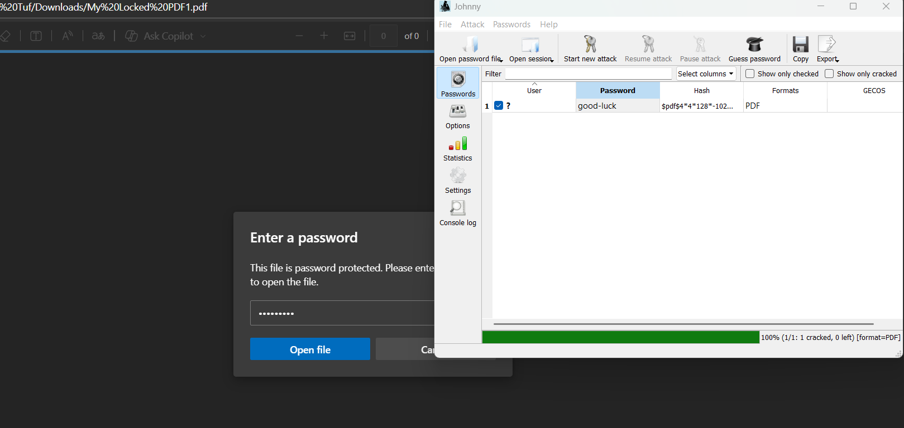
The PDF opened and revealed the lab completion flag:

```
nw{cybersecurity_flag_captured_2608}
```

**Screenshot — Flag captured (W3-PM1)**
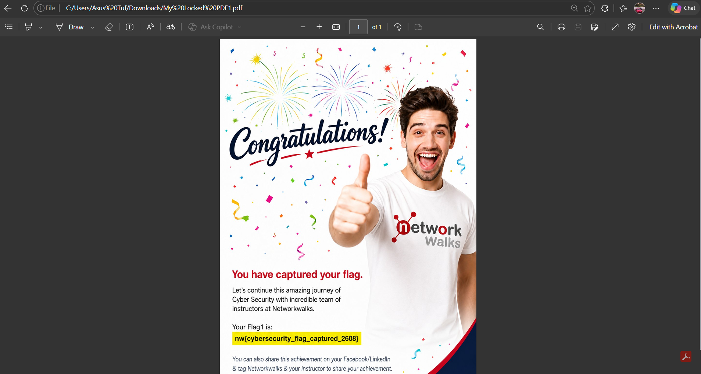

---

## 4. Methodology 2: Web-Based Cracking (Networkwalks Tools)

To see the same cracking logic applied without installing any local CLI tool, this second part used two free browser-based tools built by Networkwalks.

**Target file:** `My Locked PDF1 (for NW Tools Lab WK3-PM2).pdf`

### 4.1 Hash extraction via the Networkwalks Hash Calculator

Opened the Networkwalks Hash Calculator (`networkwalks.com/hash-calculator/`) and selected the PDF tab.

**Screenshot — Hash Calculator, empty state**
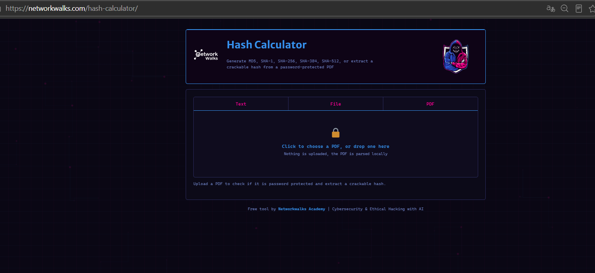

Uploaded the encrypted file. It was parsed locally in the browser (confirmed as Revision 4 / Version 4, 128-bit key), and the tool generated a pdf2john/hashcat-compatible hash:

```
$pdf$4*4*128*-1060*1*16*55d1a5c14175da449753199e44971d32*32*777fd021a7f3c5ae598c0c6495c7f76e00000000000000000000000000000000*32*ceecdac74b19b5a62688d3b3524e1374c955cbb9cc3c45316494d9446ef81af1
```

**Screenshot — Hash extracted by the Hash Calculator**
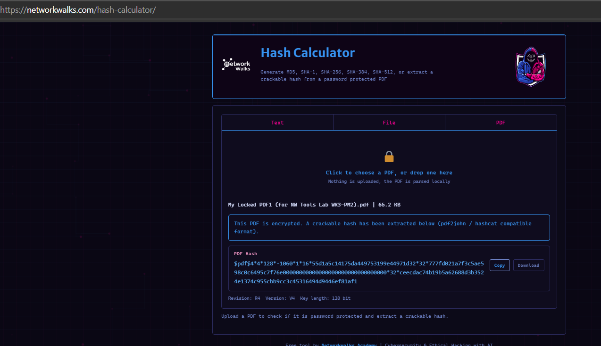

Copied the complete hash value for the next step.

### 4.2 Dictionary attack via the Networkwalks Password Cracker

Opened the Networkwalks Password Cracker (`networkwalks.com/password-cracker/`), a lab tool that hashes every word in a wordlist and checks it against a pasted PDF hash — the same core idea John the Ripper uses.

**Screenshot — Password Cracker, empty state**
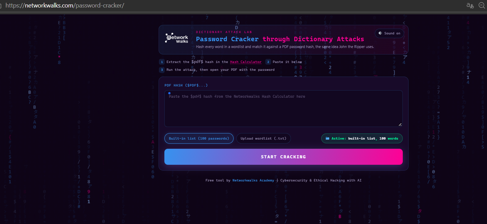

Pasted the extracted `$pdf$...` hash into the **PDF HASH** field and kept the built-in 100-password list active.

**Screenshot — Hash pasted into the Password Cracker**
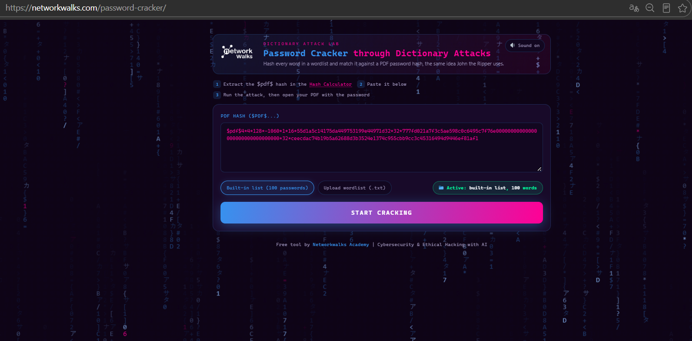

Clicked **START CRACKING**. The tool worked through the list (service, canada, hockey, killer, george, asd#gh, zxcvbn, qwertyuiop, 111222…) and found a match at 91 of 100 words tried:

**Password recovered: `password1`**

**Screenshot — Password match found**
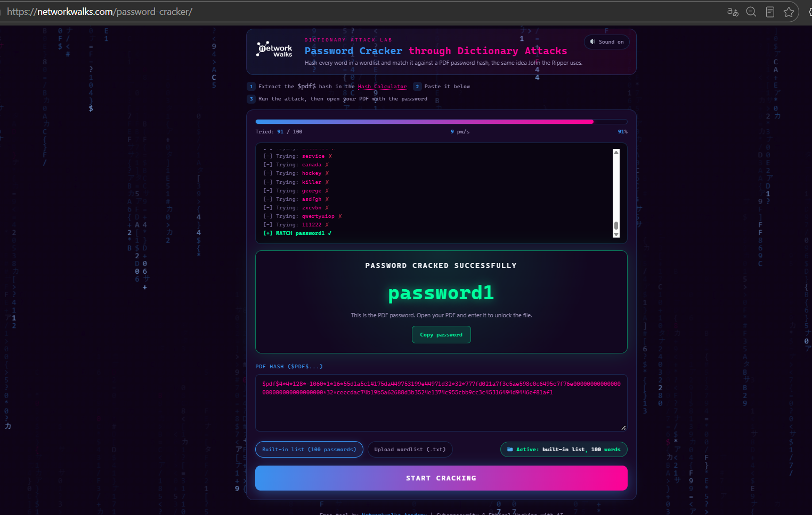

**Screenshot — Browser confirmation of the match**
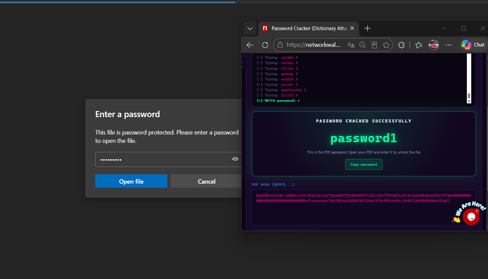

### 4.3 Document unlocking & flag capture

Used `password1` to unlock `My Locked PDF1 (for NW Tools Lab WK3-PM2).pdf`. Access was verified by the lab completion flag inside the document:

```
nw{networkwalks_flag1_jtr_270521_1}
```

**Screenshot — Flag captured (W3-PM2)**
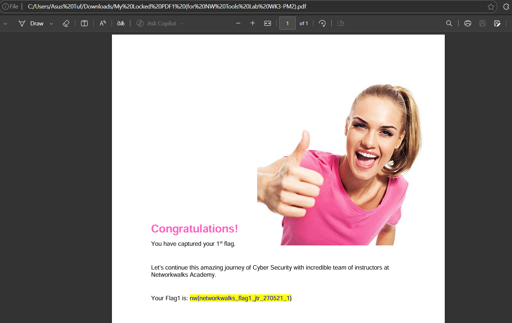

---

## 5. Key Takeaways & Remediation

**Vulnerability:** both target files were protected with a short, dictionary-guessable password (`good-luck`, `password1`). A hash extracted from a protected file — whether through a local JTR workflow or a pure browser-based tool — can be cracked within seconds to minutes once it is run against even a very small wordlist (100 words was enough for both files in this lab).

**Remediation:**
- Enforce strong password policies for anything that protects a document: 12+ characters, mixing uppercase, lowercase, numbers and symbols.
- Avoid dictionary words, names, and common patterns entirely, even with added numbers or symbols tacked on.
- Pair strong passwords with a modern encryption standard (e.g. AES-256) — encryption strength only matters if the password behind it can't be guessed.
- Treat any password-protected file as sensitive the moment a copy of it leaves your control, since an attacker can then crack it offline, at their own pace, with no way for the owner to detect the attempt.

---

## 6. Evidence Checklist

**Methodology 1 — JTR / Johnny**


**Methodology 2 — Networkwalks Tools**


